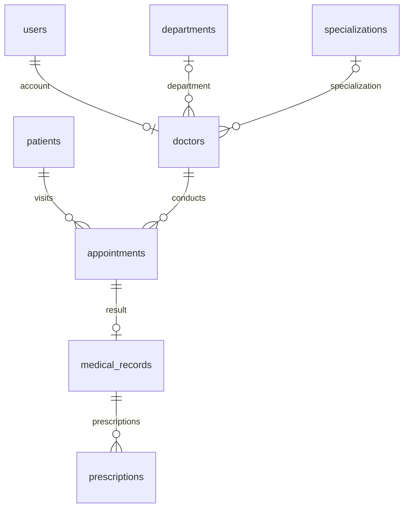

# Описание базы данных Hospital Management System для аудита

Дата проверки: **27 октября 2026 года**.

Документ составлен по рабочей базе `hospital_db`, метаданным MariaDB и исходному коду PHP. Выполнены чтение схемы и агрегатные проверки данных. Структура и содержимое базы при подготовке документа не изменялись. Персональные записи, пароли и их хеши в документ не включены.

## 1. Назначение и границы

База обслуживает учебную систему записи на приём в поликлинике — тему №4 «Емханадағы қабылдауға жазылу жүйесі». Она хранит пользователей, отделения, специальности, врачей, пациентов, приёмы, медицинские записи и рецепты.

Основной процесс: регистрация пациента → выбор врача и времени → запись на приём → завершение консультации с медицинской записью → добавление рецептов → формирование отчётов.

В рабочей базе физически находятся **22 таблицы**. Из них **8 таблиц относятся к приложению**. Остальные 14 — отдельные учебные таблицы `hospital_patients`, `hospital_appointments` и `stage*`, используемые в практических работах и демонстрации нормализации. Их нельзя смешивать с основной моделью при подсчёте данных приложения. Учебная `stage0_unnormalized` намеренно не соответствует требованиям нормализованной рабочей схемы.

## 2. Технические характеристики

| Параметр | Проверенное значение |
| --- | --- |
| Название базы | `hospital_db` |
| СУБД | MariaDB 10.4.32, среда XAMPP |
| Движок основных таблиц | InnoDB |
| Кодировка | `utf8mb4` |
| Сравнение строк | `utf8mb4_general_ci`; у справочника `specializations` — `utf8mb4_unicode_ci` |
| Подключение приложения | PHP, PDO MySQL, `charset=utf8mb4` |
| Обработка ошибок PDO | Исключения; пользователю при сбое подключения выводится общее сообщение |
| Число основных записей | 97 на дату проверки |

Различие collations не препятствует текущим числовым внешним ключам, но должно учитываться при будущих сравнениях и объединениях текстовых полей.

## 3. Состав основных таблиц

Во всех восьми таблицах есть первичный ключ `id INT AUTO_INCREMENT`. В таблицах, кроме справочника `specializations`, есть `created_at` и `updated_at`; последнее поле обновляется при изменении строки. Эти отметки времени не заменяют журнал аудита.

| Таблица | Записей | Назначение и ключевые поля |
| --- | ---: | --- |
| `users` | 11 | Учётные записи: `username`, `password_hash`, `role`, `first_name`, `last_name`, `is_active` |
| `departments` | 6 | Отделения: `name`, `description` |
| `specializations` | 7 | Справочник специальностей: уникальное `name` |
| `doctors` | 8 | Профили врачей: `user_id`, `department_id`, `specialization_id`, `phone`, вычисляемое `user_role` |
| `patients` | 20 | Пациенты: имена, `dob`, `gender`, `phone`, `email`, `address` |
| `appointments` | 22 | Приёмы: `patient_id`, `doctor_id`, `appointment_date`, `appointment_time`, `reason`, `status`, вычисляемое `occupied_slot` |
| `medical_records` | 11 | Результаты консультаций: `appointment_id`, `diagnosis`, `treatment`, `notes` |
| `prescriptions` | 12 | Назначения: `medical_record_id`, `medicine_name`, `dosage`, `frequency`, `duration` |
| **Всего** | **97** | Только основные таблицы приложения |

Используются `INT` для идентификаторов, `VARCHAR` для ограниченных строк, `TEXT` для описаний и медицинского текста, `DATE` для дат, `TIME` для времени и `TIMESTAMP` для технических отметок.

Роль пользователя ограничена значениями `Admin`, `Doctor`, `Receptionist`. Пол пациента — `Male`, `Female`, `Other`. Статус приёма — `Scheduled`, `Completed`, `Cancelled`.

## 4. Связи и модель данных

- Каждый профиль врача связан ровно с одним пользователем; один пользователь может иметь не более одного профиля врача. Не каждый пользователь является врачом.
- Отделение и специальность врача могут не быть назначены: оба поля допускают `NULL`.
- Каждый приём принадлежит одному пациенту и одному врачу. У пациента и врача может быть много приёмов.
- На один приём допускается не более одной медицинской записи; у запланированного приёма её может ещё не быть.
- Одна медицинская запись может иметь несколько рецептов.

Справочники, профили, события и результаты консультаций хранятся отдельно. ФИО врача не копируется в каждый приём: приложение получает его через `JOIN`. Лекарства пока хранятся текстом в рецептах, отдельного справочника препаратов нет. Формальное доказательство соответствия всем нормальным формам не выполнялось.

## 5. Ограничения целостности

### Первичные, уникальные и обязательные значения

- `users.username`, `departments.name`, `specializations.name` уникальны.
- `doctors.user_id` имеет `NOT NULL` и `UNIQUE`: профиль без пользователя или второй профиль того же пользователя невозможен при обычном выполнении SQL с включёнными ограничениями.
- `medical_records.appointment_id` имеет `NOT NULL` и `UNIQUE`.
- Обязательны идентификаторы пациента и врача приёма, его дата и время; идентификатор медицинской записи рецепта; диагноз; основные реквизиты рецепта; имена, дата рождения и телефон пациента.
- `patients.email` и телефон не уникальны. База не гарантирует отсутствие двух карточек одного человека.

### Роль владельца профиля врача

В `doctors.user_role` автоматически вычисляется постоянное значение `Doctor`. Составной внешний ключ `(user_id, user_role)` ссылается на `(users.id, users.role)`. Для родительской пары создан уникальный индекс `unique_user_role`.

Поэтому профиль нельзя связать с регистратором или администратором. Смена роли пользователя, имеющего профиль врача, напрямую отклоняется внешним ключом. В приложении смена роли разрешается только для врача без приёмов: сначала удаляется неиспользуемый профиль, затем в той же транзакции меняется роль. Для врача с историей предлагается деактивация.

### Защита от двойной записи

В `appointments.occupied_slot` вычисляется `NULL` для отменённого приёма и `1` для остальных состояний. Уникальный индекс `unique_doctor_slot` охватывает `(doctor_id, appointment_date, appointment_time, occupied_slot)`.

Индекс предотвращает совпадение точного времени неотменённых приёмов одного врача, включая конкурентные вставки. Отменённый слот можно занять повторно. Завершённый приём продолжает занимать исходный слот.

Ограничение не моделирует длительность приёма: интервалы 09:00–09:30 и 09:15–09:45 оно не сравнивает. Также оно не запрещает пациенту записаться одновременно к разным врачам.

### Правила удаления

| Дочерняя связь | Действие при удалении родителя |
| --- | --- |
| `doctors` → `users` | `RESTRICT`: пользователь с профилем врача не удаляется |
| `doctors` → `departments` | `SET NULL`: врач сохраняется без отделения |
| `doctors` → `specializations` | `RESTRICT`: используемая специальность не удаляется |
| `appointments` → `doctors` | `RESTRICT`: врач с приёмами не удаляется |
| `appointments` → `patients` | `CASCADE`: удаление пациента SQL-запросом удаляет его приёмы |
| `medical_records` → `appointments` | `CASCADE`: удаление приёма удаляет медицинскую запись |
| `prescriptions` → `medical_records` | `CASCADE`: удаление медицинской записи удаляет рецепты |

Последние три связи образуют цепочку каскадного удаления медицинской истории. Веб-интерфейс отдельно запрещает удалять пациента с приёмами, но прямой SQL-запрос с достаточными правами обходит эту проверку приложения.

## 6. Транзакции и правила приложения

- Создание и изменение приёма выполняются в транзакции. При изменении и отмене проверяется состояние и блокируется строка приёма через `FOR UPDATE`.
- Через интерфейс разрешено менять или отменять только запланированные приёмы без медицинской записи.
- Сохранение медицинской записи и перевод приёма в завершённое состояние выполняются в одной транзакции; принадлежность приёма врачу перепроверяется с блокировкой.
- Учебные данные добавляются транзакционно, с блокировкой параллельного запуска и проверками повторного импорта.
- Добавление одинаковых специальностей нормализует пробелы; уникальность имён определяется collation справочника без учёта регистра.

Статус завершения, наличие медицинской записи и право врача редактировать приём не полностью выражены декларативными ограничениями схемы. Соответствующие правила зависят от PHP-кода и могут быть нарушены прямыми SQL-изменениями.

## 7. Доступ и защита информации

| Роль приложения | Область доступа |
| --- | --- |
| `Admin` | Пользователи, врачи, отделения, агрегированные отчёты |
| `Receptionist` | Карточки пациентов, запись на приём, изменение и отмена допустимых приёмов |
| `Doctor` | Свои приёмы и редактирование связанных медицинских записей/рецептов; история доступных пациентов |

Для просмотра истории врач должен иметь неотменённый приём данного пациента. После этой проверки он видит завершённые приёмы пациента, в том числе у других врачей. Это текущая политика приложения, которую следует подтвердить при согласовании доступа к медицинским данным.

Пароли хранятся в виде хешей `password_hash`, проверяются через `password_verify`. После входа идентификатор сессии обновляется. На защищённых запросах активность и роль пользователя перепроверяются по базе; деактивация прекращает доступ при следующем таком запросе.

Для форм используются CSRF-токены, для вывода текста — функция экранирования HTML; запросы с параметрами пользователя в проверенных обработчиках выполняются через подготовленные выражения PDO.

Роли приложения не являются отдельными пользователями MariaDB. По умолчанию PHP подключается к базе через `root` без пароля, если настройки не переопределены переменными `HOSPITAL_DB_*`. Разделение полномочий сейчас обеспечивается преимущественно приложением. Локальное подключение `root` без пароля было использовано и в этой проверке.

## 8. Результаты проверок текущих данных

| Проверка | Найдено нарушений |
| --- | ---: |
| Врач без пользователя или с пользователем другой роли | 0 |
| Приём без существующего пациента или врача | 0 |
| Медицинская запись без существующего приёма | 0 |
| Рецепт без существующей медицинской записи | 0 |
| Завершённый приём без медицинской записи | 0 |
| Медицинская запись у незавершённого приёма | 0 |
| Несколько неотменённых приёмов врача на один точный слот | 0 |
| Пустой статус приёма (`NULL`) | 0 |
| Пустой флаг активности пользователя (`NULL`) | 0 |

Из 22 приёмов: 7 запланированы, 11 завершены, 4 отменены. Три восстановленных аккаунта врача существуют и остаются неактивными. Их имена и пароли должен настроить администратор перед активацией.

Проверки выше относятся к связям и отдельным бизнес-правилам. Они не подтверждают правильность каждого имени, контакта, диагноза, даты или медицинского назначения. Дополнительные демонстрационные данные вымышлены; происхождение каждой старой записи отдельно не устанавливалось.

## 9. Резервное копирование и сопровождение

В проекте имеются ручные SQL-копии `before_demo_20261013.sql` и `before_doctor_repair_20261013.sql` в `database/backups/`. Каталог исключён из Git. Наличие файлов подтверждено; полное тестовое восстановление этих копий в рамках текущего описания не выполнялось.

Схема для новой установки находится в `database/hospital.sql`. Этот файл начинает с `DROP DATABASE`: его повторный импорт удаляет существующую базу. Для существующей установки предназначены `database/upgrade.php` и, при проблемах профилей, `database/repair_doctors.php`. Дополнительные учебные данные добавляет `database/seed_demo.php`.

DDL-операции обновления схемы в целом не образуют одну откатываемую транзакцию. Перед миграцией нужна резервная копия, а после сбоя — проверка завершённых этапов и повторный запуск предусмотренного обновления.

По ранее зафиксированному прогону проекта прошли 144 автоматические проверки. В рамках подготовки этого документа повторялись только чтение схемы и перечисленные агрегатные проверки, весь набор тестов заново не запускался.

## 10. Вопросы и приоритеты для аудита

| Приоритет | Наблюдение | Рекомендуемое действие |
| --- | --- | --- |
| Высокий перед использованием вне учебного компьютера | Приложение имеет подключение `root` без пароля по умолчанию | Создать отдельного пользователя БД с необходимыми правами и задать секрет вне исходного кода |
| Высокий | В основной модели нет журнала, кто и что изменил; `updated_at` хранит лишь время последнего изменения | Добавить журнал действий с исполнителем, объектом, действием и временем; согласовать доступ и срок хранения |
| Высокий | Каскадное SQL-удаление пациента может удалить всю его медицинскую историю | Согласовать архивирование/мягкое удаление и ограничить права на прямое удаление |
| Высокий перед публикацией | В каталоге проекта лежат резервные SQL-копии, тестовые скрипты и `dump.php`; последний не проверяет авторизацию | Вынести копии за веб-корень, исключить диагностические/тестовые файлы из доступной веб-части; отдельно проверить HTTP-доступ. Исключение из Git не ограничивает доступ по HTTP |
| Средний | `appointments.status` и `users.is_active` допускают `NULL`, хотя в текущих данных таких значений нет | Закрепить `NOT NULL` после проверки совместимости и существующих данных |
| Средний | Для дат в PHP в ряде мест проверяется главным образом заполненность | Усилить проверки формата и допустимых значений; добавить проверяемые правила там, где они стабильны |
| Средний | Контакты пациента не идентифицируют его уникально | Согласовать поиск дублей и правила объединения карточек; не назначать уникальность телефона без анализа общих семейных номеров |
| Средний | Расписание учитывает точное время, но не длительность, рабочие часы и пересечения приёмов пациента | Уточнить требования и при необходимости расширить модель расписания |
| Средний | Доступ врача к общей истории пациента и сроки хранения данных формально не описаны | Зафиксировать согласованную матрицу доступа и регламент хранения |
| Средний | Подтверждены ручные копии; регулярность копирования, внешнее хранение и восстановление не проверены | Организовать расписание копирования и проверку восстановления с целевыми сроками |

## 11. Итог для аудитора

Основная модель соответствует назначению системы записи в поликлинику: восемь связанных таблиц, первичные и внешние ключи, справочники, уникальные ограничения и транзакционные операции. В проверенных текущих данных нарушений связей и двойных записей на точный слот не обнаружено.

Для учебного проекта подготовлена работоспособная структура. Это описание не является заключением о готовности к эксплуатации с реальными медицинскими данными или о соответствии законодательству и отраслевым стандартам. Перед таким использованием требуют отдельной проверки права БД, аудит изменений, удаление и хранение истории, публикация служебных файлов, резервное восстановление и согласование доступа.
